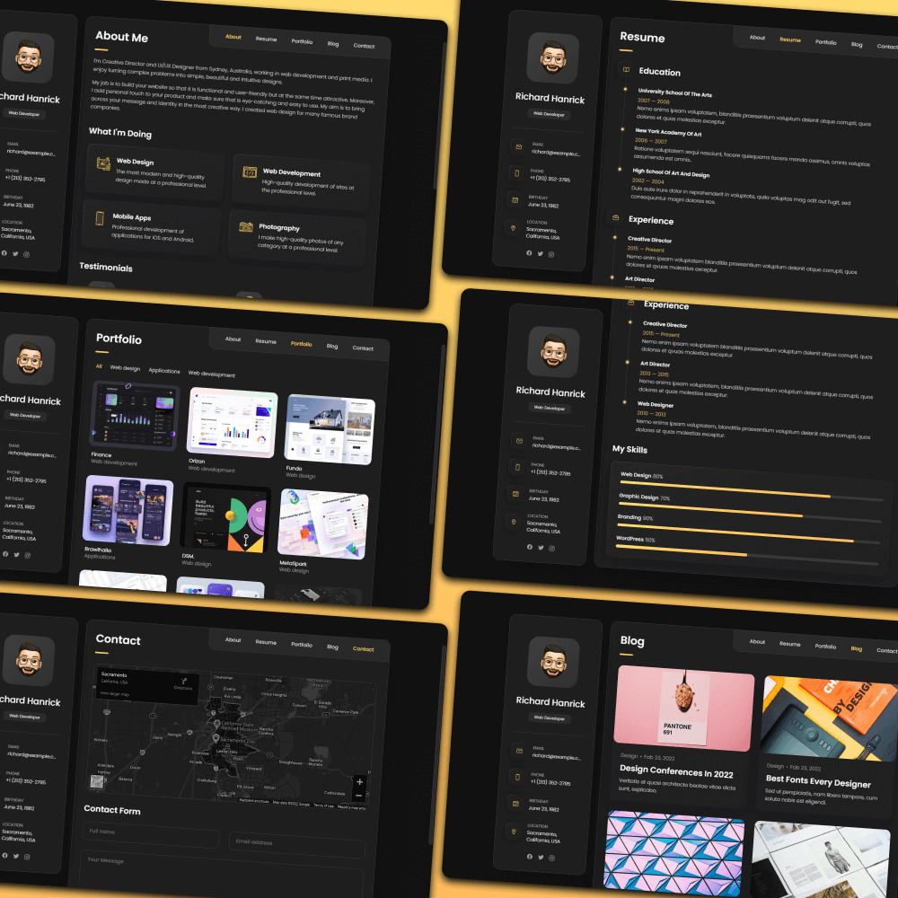
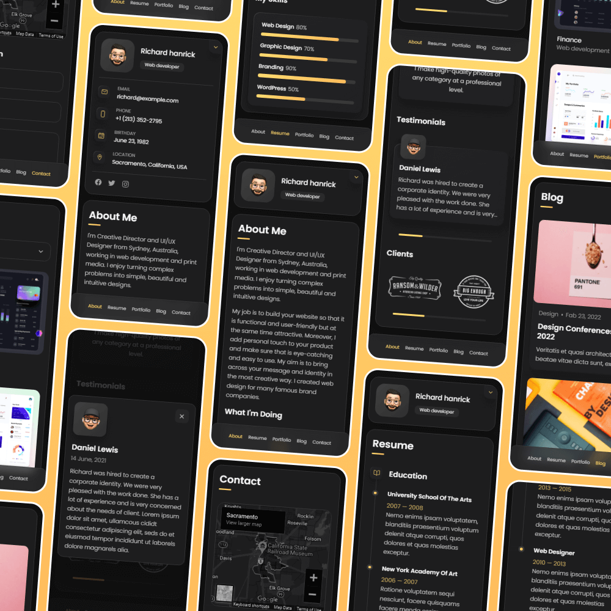

# Devarsh Sukhadiya - Personal Portfolio

A fully responsive personal portfolio website showcasing my work as a Data Scientist, built using HTML, CSS, and JavaScript.

## Demo

## Prerequisites

Before you begin, ensure you have met the following requirements:

* [Git](https://git-scm.com/downloads "Download Git") must be installed on your operating system.

## About

This is my personal portfolio website showcasing my experience in data science, software engineering, and quantitative finance. The website includes sections for About, Resume, Portfolio, and Contact.

## Technologies Used

- HTML5
- CSS3
- JavaScript
- Responsive Design
- Google Fonts
- Ion Icons

## Contact

- **Email**: dsukhadi@asu.edu
- **Phone**: +1 (602) 710-5238
- **LinkedIn**: [devarshsukhadiya22](https://www.linkedin.com/in/devarshsukhadiya22/)
- **Location**: Tempe, AZ, USA

## License

MIT
